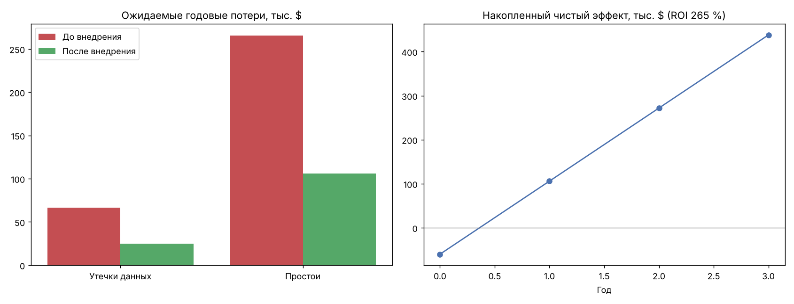
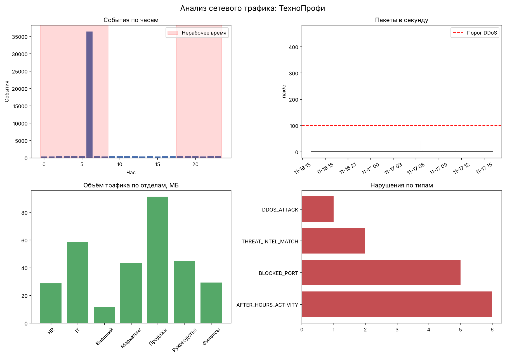

# Система мониторинга сетевого трафика предприятия

Самостоятельная работа по лекции 7 «Обеспечение сетевого трафика предприятия», дисциплина «Обеспечение информационной безопасности бизнес-процессов».

Выполнила: Миньковская Ксения Максимовна, группа Б1123-38.03.05ба(2), ДВФУ.

За основу взят прототип из лекции — класс `NetworkTrafficAnalyzer` для компании «ТехноПрофи» (200 сотрудников). В нём доработано всё, что требуется в заданиях 1–3.

## Что сделано

### Задание 1. Анализ и улучшение

| Требование | Где | Как реализовано |
|---|---|---|
| Обнаружение DDoS по пакетам в секунду | `monitor/ddos.py` | PPS считается по каждому адресу назначения. Порог — большее из двух значений: 100 пак/с или медиана + 6σ (σ через MAD, чтобы атака не завышала свой же порог). Секунды с превышением объединяются в инцидент. Если 80 % пакетов пришли от 20 и более источников, это DDoS (CRITICAL), иначе DoS (HIGH) |
| Журнал аудита для соответствия стандартам | `monitor/audit.py` | JSON Lines: номер, время UTC, кто, что, критичность, результат. Записи связаны цепочкой хешей SHA-256, поэтому изменение или удаление строки обнаруживается методом `AuditLogger.verify()`. Ориентир — мера A.8.15 ISO/IEC 27001:2022 и группа мер РСБ Приказа ФСТЭК № 21 |
| Оповещения в Telegram/Slack | `monitor/alerts.py` | Telegram Bot API (`sendMessage`) и Slack Incoming Webhooks. Фильтр по критичности, подавление повторов (не чаще раза в 5 минут для одного типа и источника), каждая отправка пишется в аудит. Без токенов работает в режиме вывода в консоль |

### Задание 2. Бизнес-кейс

Расчёт ROI — `monitor/roi.py`, пояснения и источники — [docs/roi.md](docs/roi.md). Используются данные Ponemon Institute: средняя стоимость утечки 4,44 млн долл. (IBM/Ponemon, 2025) и стоимость минуты простоя 8 851 долл. (Ponemon/Emerson, 2016).

Результат для базового сценария: выгода около 201 тыс. долл. в год, ROI за 3 года — 265 %, окупаемость — 4,3 месяца.



### Задание 3. Интеграция

| Система | Модуль | Что делает |
|---|---|---|
| Биометрическая аутентификация | `integrations/biometric.py` | Критичные действия (например, снятие блокировки IP) подтверждаются биометрией через декоратор `@require_biometric`. Сравнение шаблонов по косинусной близости, проверка живости, блокировка после 3 неудачных попыток, запись в аудит. Есть адаптер к внешнему REST-сервису биометрии |
| AWS | `integrations/cloud.py` | Метрики в CloudWatch, события в CloudWatch Logs, отчёты в S3 (boto3) |
| Azure | `integrations/cloud.py` | События и метрики через Azure Monitor Logs Ingestion API, отчёты в Blob Storage |
| MISP | `integrations/threat_intel.py` | Поиск IP через `POST /attributes/restSearch` |
| AlienVault OTX | `integrations/threat_intel.py` | Репутация IP через `GET /api/v1/indicators/IPv4/{ip}/general` |

Облачные SDK и ключи API не обязательны: без них модули работают в режиме dry-run, а база угроз берётся из учебного файла `data/threat_feed_sample.json` (адреса из диапазонов для документации, RFC 5737). В облако уходят только метрики и технические события без персональных данных — с учётом требования ч. 5 ст. 18 152-ФЗ о локализации ПДн.

## Запуск

```bash
python -m venv .venv
# Windows: .venv\Scripts\activate    macOS/Linux: source .venv/bin/activate
pip install -r requirements.txt
python main.py          # демонстрация всех трёх заданий
python -m pytest        # 32 теста
python -m monitor.roi   # только расчёт ROI
```

Чтобы оповещения реально уходили в Telegram или Slack, скопируйте `.env.example` в `.env` и заполните токены. Файл `.env` в репозиторий не попадает.

Результаты запуска сохраняются в папку `output/`: журнал аудита `audit.jsonl`, графики `network_traffic_analysis.png` и `roi.png`.



## Структура

```
monitor/
  analyzer.py      базовый анализатор из лекции + доработки
  ddos.py          задание 1: DDoS по пакетам в секунду
  audit.py         задание 1: журнал аудита с цепочкой хешей
  alerts.py        задание 1: оповещения Telegram / Slack
  roi.py           задание 2: расчёт ROI
integrations/
  biometric.py     задание 3: биометрическая аутентификация
  cloud.py         задание 3: AWS и Azure
  threat_intel.py  задание 3: MISP и OTX
tests/             тесты pytest
docs/roi.md        бизнес-кейс с расчётом и источниками
main.py            демонстрация
```

## Пример записи журнала аудита

```json
{"seq": 3, "timestamp": "2026-11-17T06:07:51.451+00:00", "actor": "soc-analyst",
 "event_type": "POLICY_VIOLATION", "severity": "HIGH", "source": "192.168.1.34",
 "details": {"type": "BLOCKED_PORT", "details": "Использование порта 21"},
 "prev_hash": "e7f519bf…", "hash": "…"}
```
